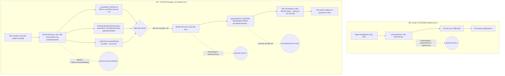
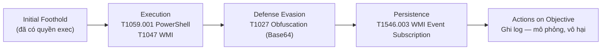
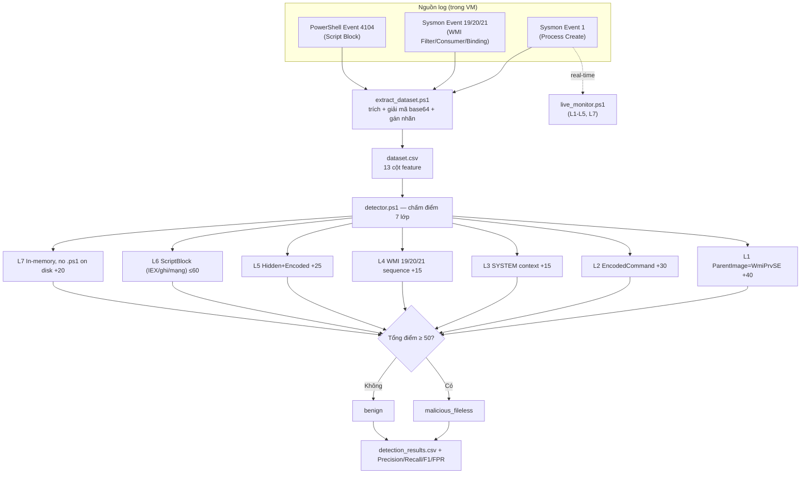

# D07 — Thiết kế: luồng thực thi & pipeline phát hiện

Tài liệu này mô tả (A) cơ chế của PoC fileless và đối chứng file-based, (B) luồng
của detector, và (C) giới hạn/điều kiện cần của PoC.

## 1. So sánh luồng thực thi: file-based vs fileless

**Điểm khác biệt cốt lõi mà detector khai thác:** ở nhánh fileless, tiến trình
`powershell.exe` có **cha là `WmiPrvSE.exe`** (không phải `explorer.exe`/`powershell.exe`),
payload **không có file `.ps1` tương ứng trên đĩa**, và trước đó có **dấu vết đăng ký WMI
(event 19/20/21)**.

## 2. Ánh xạ MITRE ATT&CK

> Lưu ý thuật ngữ: subscription tạo trong `root\subscription` là **permanent** (tồn tại
> qua reboot tới khi bị xoá), dù tên biến trong script gọi là "Temporary". Vì vậy ánh xạ
> Persistence chính xác là **T1546.003**.

## 3. Pipeline phát hiện (detector 7 lớp)

Detector **độc lập với PoC**: nó chỉ đọc log, không gọi script tấn công. Các lớp dùng
nhiều nguồn khác nhau (process tree, command-line, ngữ cảnh user, chuỗi sự kiện WMI, nội
dung script, dấu vết memory) nên một kỹ thuật né một lớp vẫn còn các lớp khác bắt.

## 4. Giới hạn & điều kiện cần của PoC

**Điều kiện để PoC chạy được:**
- Cần quyền **Administrator**: ghi vào namespace `root\subscription` yêu cầu quyền cao.
  Không có admin thì không tạo được subscription.
- Cần WMI service (`Winmgmt`) hoạt động bình thường (mặc định luôn bật trên Windows).
- Trong lab, nhóm tắt rule ASR của Defender để PoC chạy; nếu bật đầy đủ EDR/ASR, Consumer
  có thể bị chặn (xem SAFETY.md).

**PoC KHÔNG bao phủ (giới hạn phạm vi — có chủ đích):**
- Không có bước lấy quyền ban đầu: giả định "đã có foothold" như slide 8.
- Không C2, không tải payload từ xa, không exfiltration, không credential theft.
- Payload chỉ ghi 1 dòng log; không mô phỏng hành vi phá hoại thật.
- Chỉ 1 cơ chế trigger (Win32_LocalTime). Các trigger WMI khác (logon, process start,
  __TimerInstruction…) không nằm trong phạm vi bản này.

**Giới hạn của detector:**
- Phụ thuộc hoàn toàn vào log: nếu kẻ tấn công tắt Sysmon/PowerShell logging thì mất tác dụng.
- Chấm điểm theo luật tĩnh (rule-based), chưa có học máy; ngưỡng 50 đặt thủ công.
- `WmiSubCount` trong dataset đi kèm được gán theo quy tắc (xem README) — cần thu lại
  event 19/20/21 thật để đo chính xác lớp 4.
